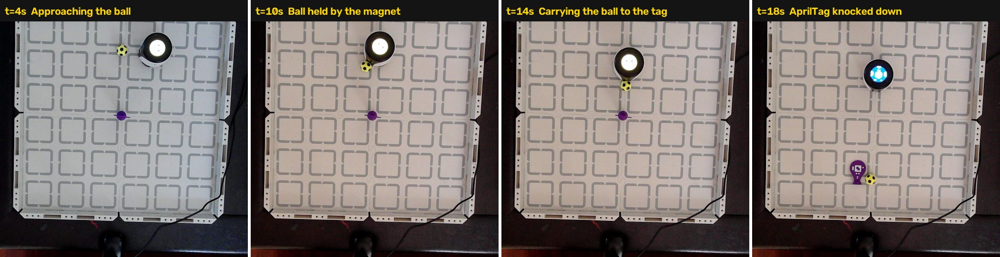
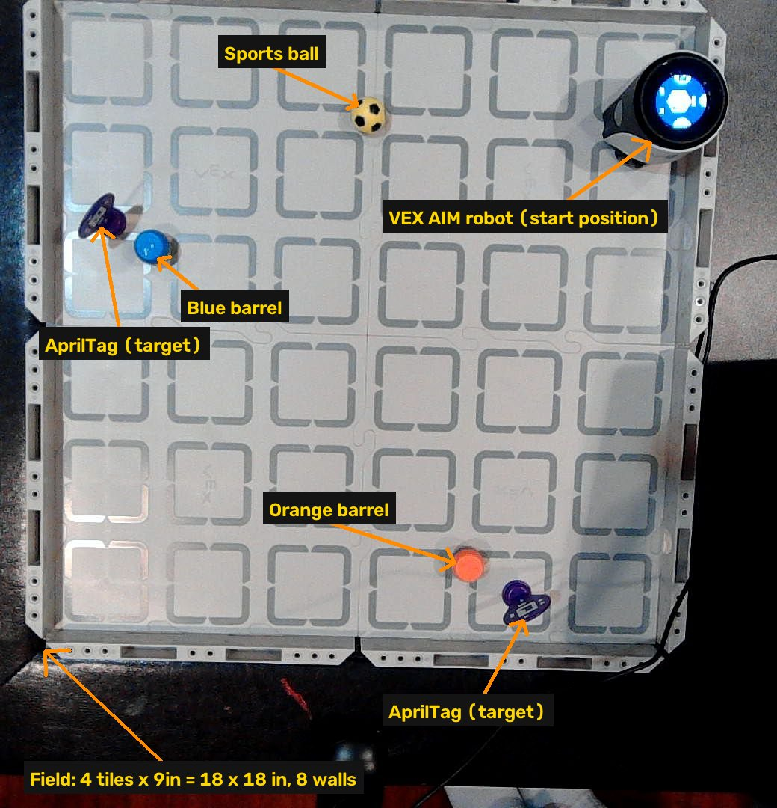
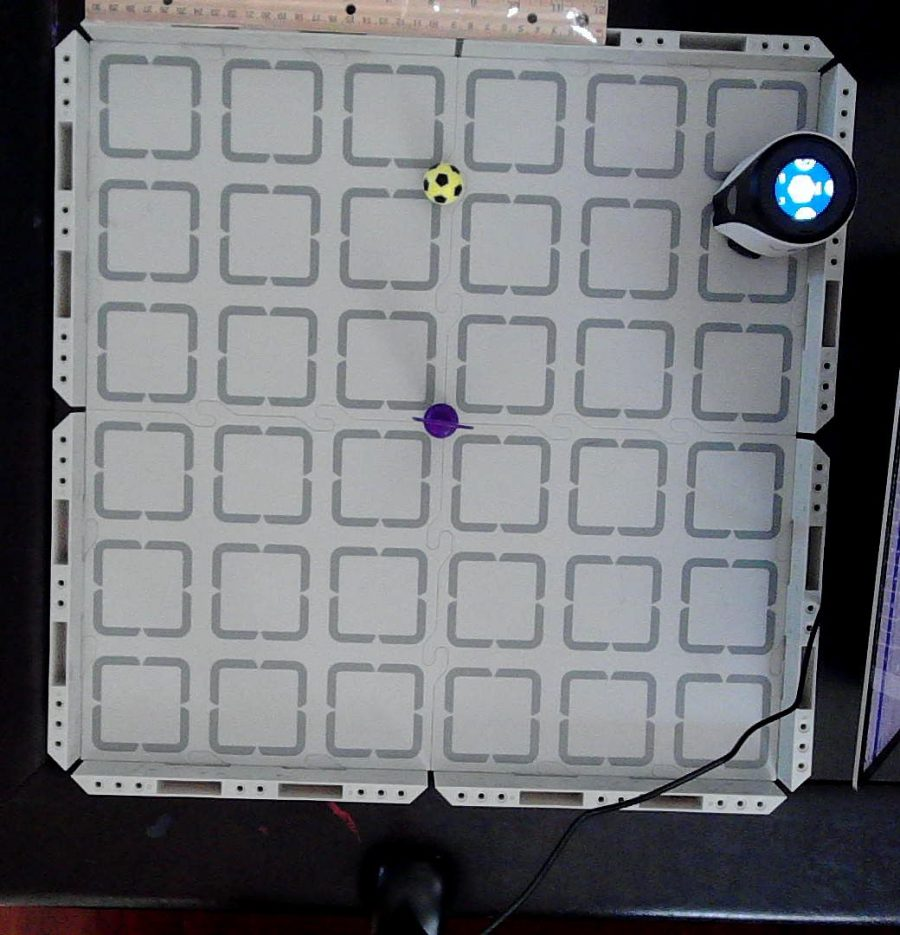
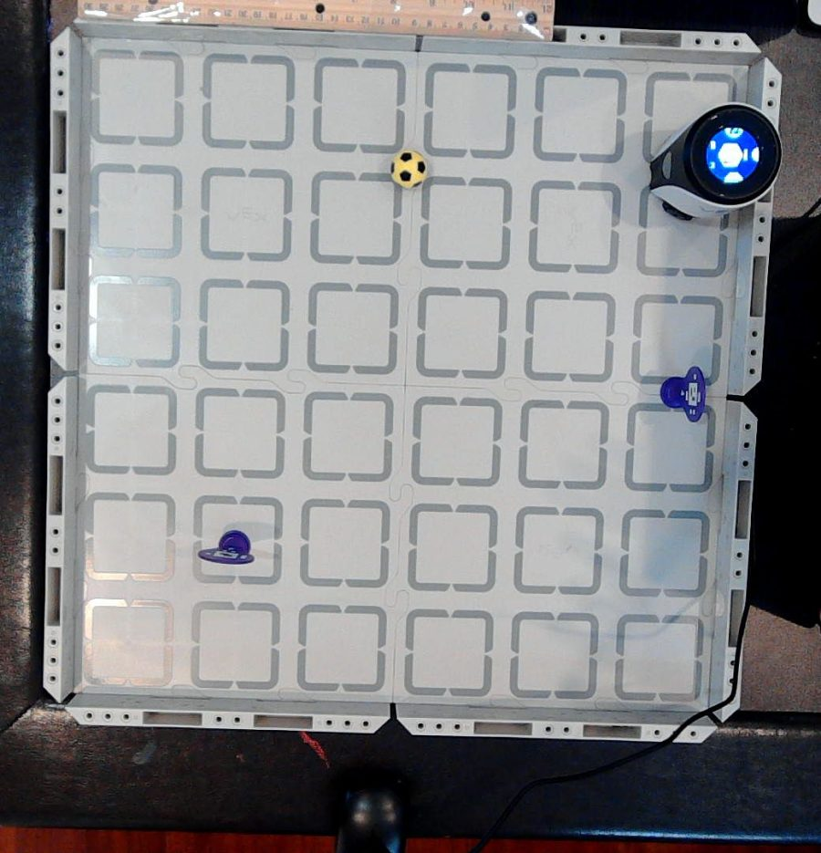
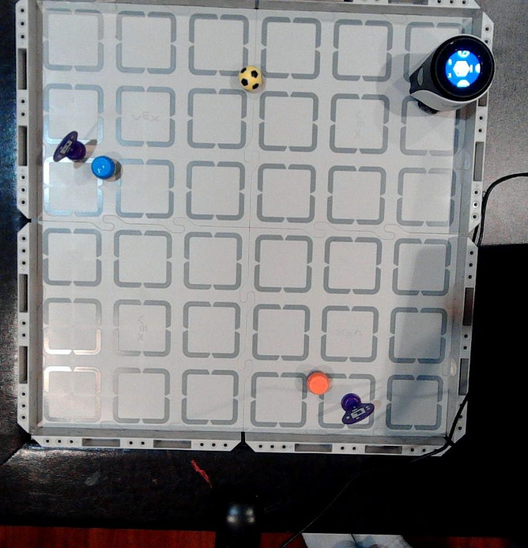
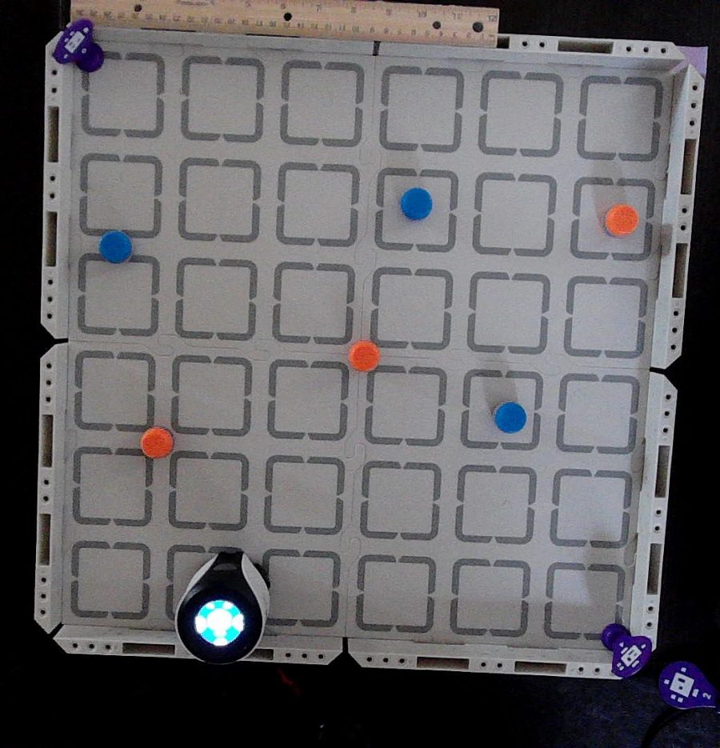

# robo-bench — VEX AIM AI Benchmark

A benchmark that measures how well AI models can program a real robot.
Each model writes Python for a [VEX AIM](https://www.vexrobotics.com/aim-kits.html) robot
to play a game, such as "grab the ball and knock down an AprilTag target". The code runs
on the robot while an overhead camera films the field. The model then sees its own code,
console logs, telemetry and camera frames, and gets another attempt to improve.


*A Game 1 trial filmed by the overhead camera: approach, pick up the ball, carry it, knock the AprilTag down.*

Models currently benchmarked (see `config.yaml`):

| Name  | Model             | API                         |
| ----- | ----------------- | --------------------------- |
| Opus  | `claude-opus-5-5` | Anthropic Messages API      |
| Astra | `gpt-6-astra`     | OpenAI Responses API        |
| Muse  | `muse-spark-1.3`  | Meta Model API (Responses)  |

All models run with reasoning on at the same effort (`high`), with the same output-token
cap and the same image budget, so results are comparable.

**Contents:**
[How it works](#how-a-benchmark-works) ·
[Hardware](#hardware-and-materials) ·
[Physical setup](#physical-setup) ·
[Software setup](#software-setup) ·
[The games](#the-benchmark-games) ·
[Reproducing the benchmark](#reproducing-the-benchmark) ·
[Configuration](#configuration-configyaml) ·
[Results on disk](#where-results-are-stored) ·
[Troubleshooting](#troubleshooting)

---

## How a benchmark works

```
Game  ──►  Experiment (one model)  ──►  Attempt 1 ──► Trials ──► Attempt 2 ──► … (max 3 attempts)
```

- **Game**: a field layout plus a written objective (see [`games/`](games/)).
- **Experiment**: one model playing one game, in one of two modes:
  - **Pure code**: the model writes a complete Python program per attempt (the benchmark mode).
  - **LLM drive**: the model controls the robot turn by turn (move / turn / kick / scan / photo).
- **Attempt**: one generated program. Each attempt can be run for up to 3 **trials**
  of 60 s each. At least 1 completed trial is needed before the next attempt.

### What the model receives

| Attempt 1 | Attempt N (N > 1) |
| --- | --- |
| System preamble ([`system_preamble.txt`](system_preamble.txt)) | same |
| Compact VEX AIM API reference ([`vex_api_compact.txt`](vex_api_compact.txt)) | same |
| Game description (frozen when attempt 1 is generated) | same |
| Overhead photo of the field at the start | same photo |
| | Code from attempt N-1 |
| | Console logs, telemetry and camera frames from attempt N-1's trials |

Only the previous attempt's results are included, never earlier ones. Trials stopped
with the Stop button, or that crashed, are not sent to the model.

### During a trial

- The program runs on the **host computer** and drives the robot over Wi-Fi through the
  VEX AIM WebSocket Python client (vendored in `vex/`). Nothing is uploaded to the robot.
- The overhead camera captures a frame every 2 s, plus 3 s after the program ends.
- Telemetry (heading, position, vision detections, …) is recorded from the program's own
  robot connection by `robot/launcher.py`. The harness never opens a second connection,
  which would disrupt the program.
- Console output (`print()`) is captured unbuffered, so nothing is lost at the time limit.

---

## Hardware and materials

| Item | Qty | Notes | Link |
| --- | --- | --- | --- |
| **VEX AIM Coding Robot** | 1 | The robot. The kit includes a controller, sports balls, blue and orange barrels, and AprilTag signs with IDs 0–4, which is everything the games use. | [VEX AIM Coding Robot](https://www.vexrobotics.com/aim-kits.html) · [Features](https://kb.vex.com/hc/en-us/articles/35994363720340-Features-of-VEX-AIM) |
| **VEX 123 / AIM Field** (SKU 248-7350) | 1 | 4 field tiles (9″ × 9″) + 8 wall pieces, giving an **18″ × 18″** playing area. | [VEX 123/AIM Field](https://www.vexrobotics.com/248-7350.html) |
| **Overhead USB camera, 1920×1080** | 1 | We used the **EMEET SmartCam C960** (1080p30, 90° diagonal field of view, 1/4″ tripod thread). The harness only accepts a camera that delivers 1920×1080. | [EMEET SmartCam C960](https://emeet.com/products/webcam-c960) |
| Camera mount | 1 | Anything that holds the camera **face-down** above the field centre: an overhead tripod, boom arm, or desk-clamp arm with a 1/4″ screw. | — |
| 12″ ruler | 1 | Laid along the top wall of the field, so the models (and you) can judge scale in the photos. | — |
| Computer | 1 | macOS (tested on a 2019 16″ MacBook Pro, Intel i9, macOS 14.1). Must be on the same Wi-Fi network as the robot. | — |
| Wi-Fi network | 1 | The robot runs in Wi-Fi **station mode** on your network. | [Wi-Fi station mode setup](https://api.vex.com/aim/home/websocket/wifi_setup/connection_sta.html) |

Software references:

- [VEX AIM Python API documentation](https://api.vex.com/aim/home/index.html) (the source of `vex_api_compact.txt`)
- [VEX AIM WebSocket API](https://api.vex.com/aim/home/websocket/index.html) and its
  [Python library on GitHub](https://github.com/VEX-Robotics/AIM_Websocket_Library):
  the client vendored in `vex/` is **v1.0.1.0** (MIT licence), which needs robot firmware
  (AIM VEXos) **1.0.1 or later**
- [AI Vision sensor reference](https://api.vex.com/aim/home/python/AI_Vision.html) (sports ball, barrels and AprilTag detection)

---

## Physical setup


*The field as the overhead camera sees it (Game 3 layout), with every element labelled.*

1. **Build the field.** Lay the 4 tiles in a 2 × 2 square and clip the 8 walls around the
   edge. Put it on a flat, matte, non-reflective surface. Bright spots on the tiles
   confuse both the overhead camera and the robot's vision.
2. **Mount the camera** face-down, centred over the field. At our setup's scale (the 12″
   ruler spans ~615 px of the 1920 px frame) the lens is **about 55 cm / 22″ above the
   tiles**. This is an estimate from the image scale; adjust until the whole field,
   including all four walls, fills most of the frame, as in the images here. The camera
   must not move between trials.
3. **Lay the ruler** along the top wall, inside the camera's view.
4. **Lighting:** use even room lighting and avoid direct sunlight or a lamp shining on the
   field. Glare hides the AprilTags from the robot's camera.
5. **Clear the surroundings.** Keep AprilTag signs, balls and barrels that aren't part of
   the game away from the field. The robot's camera can see past the walls and may
   detect them.
6. **Connect the robot to Wi-Fi** in station mode
   ([instructions](https://api.vex.com/aim/home/websocket/wifi_setup/connection_sta.html))
   and note the IP address it shows. Check the firmware is AIM VEXos 1.0.1 or later.
7. **Place the elements** for the game you're running exactly as in that game's
   `games/<game>/start.jpg`. The robot starts in the **same position and facing the same
   way** in every trial.
8. **Charge the robot** between sessions. Low battery changes motor behaviour.

---

## Software setup

Tested with Python 3.10.11 on macOS 14.1, with `anthropic` 1.7.0, `openai` 3.16.2,
`fastapi` 0.141.1, `uvicorn` 0.42.0, `opencv-python` 5.0.0.93, `numpy` 2.2.6 and
`websocket-client` 1.9.0.

```bash
git clone https://github.com/Meher-ilovepandas/robo-bench.git
cd robo-bench
pip3 install -r requirements.txt
cp .env.example .env        # then fill in your API keys
```

`.env`:

```
ANTHROPIC_API_KEY=...     # https://console.anthropic.com
OPENAI_API_KEY=...        # https://platform.openai.com
META_API_KEY=...          # https://dev.meta.ai
```

On macOS, give your terminal app camera access in **System Settings → Privacy & Security
→ Camera**. Plug the overhead camera in **before** starting the server.

### Running

```bash
PYTHONUNBUFFERED=1 python3 -m uvicorn web.server:app --host 0.0.0.0 --port 8000 --timeout-graceful-shutdown 3
```

Then open <http://localhost:8000>.

Both flags matter:
- `PYTHONUNBUFFERED=1`: without it, harness log lines are buffered and don't appear.
- `--timeout-graceful-shutdown 3`: the live camera preview is an endless stream. Without
  a timeout, a stopped server never exits and keeps holding the camera.

### Workflow in the UI

1. **Config**: enter the robot's IP, click *Set* and then *Connect Robot*. Check that the
   camera preview shows the field.
2. **Games**: create a game and paste its description (from `games/<game>/description.txt`). Click *Save*.
3. **Experiment**: open the game's experiments, click *+ New*, and pick a model and *Pure Code*.
4. **New Attempt**: the model generates code. This can take a few minutes. The *Prompt*,
   *Code*, *Reasoning* and *Trace* tabs show exactly what was sent and returned.
5. **Start Run**: run a trial. Reset the field to the start layout before each trial.
6. **New Attempt** again: the model gets the previous attempt's results and improves.

Messages that need attention (camera stopped, robot unreachable, a model API error) pop
up in the bottom-right corner.

---

## The benchmark games

Each game's exact description, as given to the models, is in `games/<game>/description.txt`.
The starting layout is in `games/<game>/start.jpg`, taken from the first frame of a trial.

| Game | Objective | Starting layout |
| --- | --- | --- |
| [**Game 1**](games/game1/description.txt) | Grab the yellow ball and use it to knock down **one** purple AprilTag. |  |
| [**Game 2**](games/game2/description.txt) | Knock down **two** AprilTags with the ball, re-grabbing the ball after the first hit. |  |
| [**Game 3**](games/game3/description.txt) | Knock down **two** AprilTags without directly hitting the barrels next to them. |  |
| [**Game 4**](games/game4/description.txt) | Sort the barrels: orange to the square with AprilTag **4**, blue to the square with AprilTag **0**, within 60 s. |  |

Notes:
- In the overhead photos an AprilTag sign looks like a small purple disc with a line
  through it. Only the robot's camera can read its ID.
- The ball and barrels attach to the robot's kicker magnetically. Rotating next to a wall
  can knock them loose, as the game descriptions warn the models.
- The system preamble tells the models the field is 16″ × 16″; the real playing area is
  18″ × 18″, which the game descriptions state. The preamble was kept unchanged so new
  runs stay comparable with existing results.

---

## Reproducing the benchmark

For each game and each model:

1. Set up the field exactly as in `games/<game>/start.jpg`, robot included.
2. In the UI, create the game with the text from `games/<game>/description.txt`, then a
   **Pure Code** experiment for the model. The first image is captured when attempt 1 is
   generated, so the field must be in its start layout at that moment.
3. Generate attempt 1. Run its trials, **resetting the field to the start layout before
   every trial**.
4. Generate attempts 2 and 3, running trials after each.
5. Score each trial from its camera frames and console log against the game's objective
   (for example, was the AprilTag knocked down, and was a barrel hit directly?).

Keep these identical across models: the field layout and robot start pose, camera
position, lighting, `system_preamble.txt`, `vex_api_compact.txt`, `config.yaml`
(`max_tokens`, `max_images`, trial counts and duration), and the number of trials per
attempt. Everything each model saw and produced is saved on disk (see below), so any
result can be audited later.

---

## Configuration (`config.yaml`)

| Section | Key | Meaning |
| --- | --- | --- |
| `models` | `<Name>.api_type / model_id / max_tokens` | Models to benchmark (`anthropic`, `openai`, `meta`) |
| `retired_models` | `<Name>: model_id` | Old models whose experiments stay viewable but can't continue |
| `benchmark` | `code_attempts` | Attempts per experiment (3) |
| | `trials_per_code` | Max trials per attempt (3) |
| | `min_trials_before_next` | Trials needed before the next attempt (1) |
| | `run_duration_sec` | Trial length (60 s) |
| | `post_run_capture_sec` | Extra filming after the program ends (3 s) |
| `prompt` | `max_images` | Images per prompt, the same for every model (50, which is Muse's limit) |
| | `image_max_side_px` | Prompt images are downscaled to this size; originals are kept on disk |
| | `telemetry_interval_sec` | Telemetry rows sent to the model (one per second) |
| `robot` | `robot_ip` | Default robot IP (the last IP set in the UI is remembered) |
| `camera` | `width / height` | Resolution that identifies the overhead camera (1920×1080) |
| | `capture_fps` | Frames per second during a trial (0.5) |

---

## Where results are stored

Everything is saved under `sessions/` (git-ignored):

```
sessions/games/game_001/
├── meta.json, prompt.txt                     game name and description
└── experiments/exp_001/
    ├── config.json                           model and mode
    ├── start_image.jpg, game_prompt.txt      first photo and frozen description
    └── attempts/attempt_001/
        ├── input/prompt.txt, img_*.jpg       exactly what the model was sent
        ├── output.txt                        generated code
        ├── reasoning.txt                     the model's reasoning summary
        ├── trace.txt, harness.log
        └── runs/run_001/
            ├── console.log                   program output
            ├── telemetry.json, telemetry_series.json
            ├── frames/frame_*.jpg, frames.json   camera frames and capture times
            └── summary.json                  duration, exit code, telemetry gaps, …
```

---

## Troubleshooting

| Problem | Fix |
| --- | --- |
| Camera preview is black or frozen | Usually the Mac slept (lid closed, or on battery) or the USB cable dropped. Click **⟳ Restart server** on the Config page. To prevent it, keep the Mac on power and awake (`caffeinate -d`). |
| "No camera delivers 1920×1080" | The overhead camera isn't connected, or was plugged in after the server started. Plug it in and restart the server. The built-in camera is refused on purpose. |
| "Robot not reachable" | The robot is off, asleep, or got a new IP. Turn it on, enter its IP on the Config page, then click *Set* and *Connect Robot*. |
| Robot ignores commands or reconnects repeatedly | Check the firmware is AIM VEXos 1.0.1 or later, and that only one program is controlling the robot. |
| New Attempt is refused | Read the pop-up. Usually the previous attempt has no completed trial yet, or the experiment already has 3 attempts. |
| More than one server running | `ps aux \| grep "uvicorn web.server"` should show one process. Stop any extras before starting a new one. |

---

## Repository layout

```
harness.py              orchestrates generation, trials and drive sessions
storage.py              on-disk layout of games / experiments / attempts / runs
config.py, config.yaml  configuration (+ API keys from .env)
web/server.py           FastAPI server and API
web/static/index.html   web UI
models/                 model adapters (Anthropic; OpenAI-compatible Responses API for OpenAI and Meta)
camera/capture.py       overhead camera capture
robot/runner.py         runs a trial: subprocess, console capture, telemetry
robot/launcher.py       wraps the generated program to record telemetry
robot/daemon.py         robot connection used by LLM drive mode
vex/                    VEX AIM WebSocket Python client v1.0.1.0 (vendor code, MIT)
games/                  the benchmark games: description + starting layout
docs/images/            reference images used in this README
system_preamble.txt     system prompt given to every model
vex_api_compact.txt     API reference given to every model
vex_api.txt             full scraped VEX AIM API docs (download_api.py)
```
